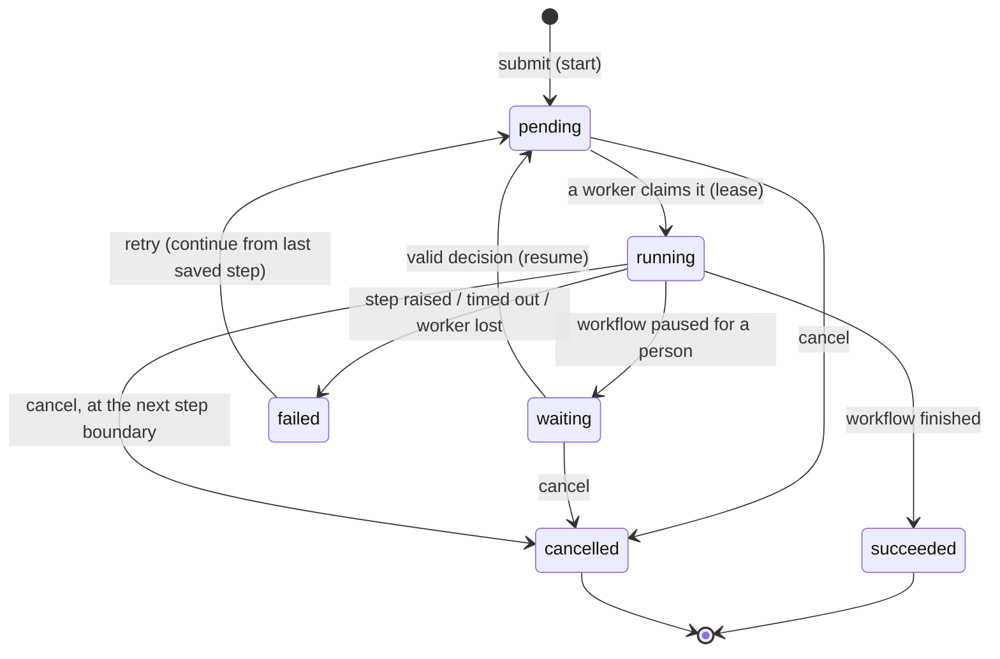

# Base platform, phase 1: design draft

Status: draft for architect review, 2026-11-26. Phases 1 and 2 (§12) are built: `foundation/`, `workflows/echo.py`, `workflows/clip.py`, `tests/test_foundation.py`, `tests/test_clip_workflow.py`. Phase 3's first part, the workbench pages (`foundation/web/`, served by the API), is built. The second workflow, `report` (§6), is built and the platform suite runs unchanged on `echo`, `report` and `clip` (`tests/test_platform_suite.py`). Phase 4, material intake (§14), is built and ran on the pilot's material. Uploads and recovery from a database restart (§15), worker presence with a health page (§16), and restarts, backups and health checks (§17), are built. The workbench now looks like Yuxi's web client (each task as a conversation with the agent); a workflow may name its tasks for lists with an optional `title(input)`. The site opens on the platform's home; apps (`registry.APPS`: workflows + a module's pages) are what people see, video editing being one of them. Feishu QR sign-in is implemented for a shared employee pilot and needs company app configuration. Per-resource authorization remains a separate step. Chinese version: [PLATFORM_DESIGN.zh.md](PLATFORM_DESIGN.zh.md).

The platform runs **workflows** as **tasks**. It owns the parts every workflow needs: registering
workflows, recording tasks, handing them to workers, pausing for a person, resuming, and delivering
files. A workflow owns only its business logic. Clipflow (product + footage → MP4) is the first
workflow; Clipflow's code is not changed, it gets an adapter.

Patterns are taken from Yuxi (MIT, read at commit `7c02f69`): register the task in a transaction
before it is sent, claim with a lease, reconcile lost workers, handler registry by type + version,
waitpoints bound to one execution. The code is our own: Yuxi's is async SQLAlchemy tied to its own
helpers, while our engine is synchronous and runs on Windows (see §8).

Contents: 1 boundaries · 2 task states · 3 the workflow interface · 4 reviews · 5 Clipflow adapter ·
6 a second workflow · 7 queue options · 8 where workers run · 9 data model · 10 API · 11 tests ·
12 build order · 13 open questions

---

## 1. Who owns what

| | Platform (`foundation/`) | Workflow (`workflows/<type>/`) |
|---|---|---|
| Identity | task id, workflow type + version, who submitted it | business input (product id, replay, script …) |
| Execution | queue, claim, lease, heartbeat, timeout, cancel, crash recovery | the steps; where its own progress is saved (Clipflow: LangGraph checkpoints) |
| Status | the user-facing status, current step, progress, error, event history | business status inside its own state |
| Human review | waitpoints, decisions, stale and duplicate rejection, who decided | what is shown, which actions exist, business validation (must-fix items …) |
| Files | artifact records, storage location, download and access | which files are deliverables |

Rule of thumb: if a second, unrelated workflow would need it too, it belongs to the platform.

```
foundation/                 platform, knows nothing about video
  contracts.py              TaskView, Command, Outcome, WaitpointSpec, ArtifactOut
  registry.py               workflow type + version → adapter (loaded lazily)
  db.py, schema.sql         connection pool; tables in §9
  tasks.py                  TaskRepository: create, claim, renew, finish (all fenced by lease)
  reviews.py                open/answer waitpoints, record decisions
  artifacts.py              record and serve files (local folder now, object storage later)
  dispatch/                 how a worker learns there is work (§7): postgres.py now, arq.py later
  worker.py                 the worker loop: claim → adapter.advance → record outcome
  api.py                    FastAPI: tasks, decisions, artifacts, workflows
workflows/
  clip/adapter.py           Clipflow behind the interface (§5)
  report/adapter.py         a small second workflow to prove reuse (§6, phase 5)
clipflow/                   unchanged engine
```

Top-level folders in one repository for now, as the plan suggests. `foundation` must not import
`clipflow` or `workflows`; a lint rule (ruff `flake8-tidy-imports` banned-api) enforces it.

## 2. Task states



- **pending** means "there is a command to execute": `start`, `resume(decision_id)` or `continue`.
  The command is stored on the task row, so any worker, in any process, can carry it out.
- **waiting** holds no worker. A clip run can wait hours for an editor without using a slot.
- **succeeded** carries a business `outcome` (`delivered`, `rejected_by_reviewer`, `stopped` …).
  A reviewer rejecting a plan is a normal ending, not a failure.
- **failed** carries `error_kind`: `step_error`, `timeout`, `worker_lost`, `bad_version`. Only a
  person or an explicit policy (below) sends it back to pending.
- `cancel_requested` is a flag, not a state: a running task stops at its next step boundary.

**Worker lost.** Yuxi marks a task whose lease expired as failed, "side effects unknown", and never
retries it automatically. We do the same, and in phases 1–2 no workflow recovers automatically: a lost
worker gives `failed / worker_lost`, and a person presses retry, which continues from the last save
point. Resuming after a review and recovering after a crash are different things and are accepted
separately (§11).

A workflow may later opt in to one automatic recovery (`recover_after_crash = n`) once re-running is
shown to be safe. For Clipflow that needs, first:

- **Safe render writes.** The old worker may still be rendering after its lease is gone, writing the
  same files as the new one. Today the renderer writes each shot (`<cache>/<hash>.mp4`) and the final
  `final_v<n>.mp4` in place with `ffmpeg -y`. A worker killed mid-write also leaves a partial shot
  file, which the cache then reuses, because it only checks that the file exists. Both must be
  written to a temporary file and renamed into place.
- **Tests that prove it.** Two renders of the same timeline at once, and a render killed mid-write,
  must both end with a valid MP4 whose checksum matches the recorded artifact.

Only then does Clipflow set `n = 1`.

*Status (2026-11-26):* both preconditions are met. The renderer writes every shot and the final video
under a temporary name and moves it into place when complete; a cached shot is reused only if
ffprobe reads it; leftovers from killed renders are swept after a day. `tests/test_render_safety.py`
kills a real render process mid-write and runs two renders of one timeline at once. What remains is
the platform side (re-queueing a lost task once when its workflow allows it), which waits for the
architect's answer to question 2 in §13.

Every state change and step progress is appended to `task_events`. That is the history the
workbench shows and what an incident review reads.

## 3. The workflow interface

One interface, called only by the worker:

```python
class Workflow(Protocol):
    type: str                       # "clip"
    version: int                    # bump when stored inputs or saved state stop being compatible
    input_model: type[BaseModel]    # validated at submit, before the task exists
    recover_after_crash: int = 0
    timeout_s: float = 3600         # per advance() call, not per task

    def advance(self, task: TaskView, command: Command, ctx: StepContext) -> Outcome: ...
    def check_decision(self, waitpoint: WaitpointView, body: dict) -> str | None:  # optional, cheap
        return None
```

`advance` runs until the workflow either finishes or needs a person, and returns one of:

```python
Waiting(key, subject_version, payload, actions, decision_schema, view, engine_key)
Finished(outcome, artifacts: list[ArtifactOut], summary: dict)
# a raised exception = failed (step_error); the platform records it
```

`StepContext` is what the workflow may use:

| method | what it does |
|---|---|
| `ctx.step(name, progress=None)` | records the current step; called between steps |
| `ctx.check()` | raises `Stop` if the lease was lost or cancel was requested; called between steps |
| `ctx.artifact_dir` | a folder for this task's deliverables |
| `ctx.log(kind, data)` | adds a business event to the task history |

The lease is renewed by a separate heartbeat thread, so a long step (a 3-minute render) never loses
it. `ctx.check()` is how the workflow learns that it must stop.

**Fencing.** Every write a worker makes (`finish`, open waitpoint, progress) is an
`UPDATE … WHERE id = %s AND worker_id = %s AND lease_expires_at > now()`. A worker that lost its lease
cannot publish a result or open a waitpoint, even if it is still running. The remaining risk: such a
worker keeps running its current step until the next `ctx.check()`, possibly alongside the new owner.
For Clipflow that step's outputs are content-addressed, so the duplicate work is wasted but harmless.

## 4. Reviews: one mechanism for every workflow

A **waitpoint** is one question to a person, bound to one task and one version of what they look at.

```
waitpoint: id, task_id, key ("confirm_plan"), subject_version (plan v3),
           payload (what to show), actions (["approve","edit","reject"]),
           decision_schema (JSON Schema), view ("clip.plan_review"), engine_key, status
```

Submitting a decision, `POST /tasks/{id}/decisions {waitpoint_id, body, client_request_id}`, in one
transaction:

1. Lock the task row. `client_request_id` already used → return the first response (double-click,
   network retry). Nothing runs twice.
2. Task not `waiting`, or `waitpoint_id` isn't the open one → **409** with the current waitpoint.
   This is how a stale browser tab is caught.
3. `workflow.check_decision` returns a problem → **422**, the waitpoint stays open. The workflow
   checks the shape with the same Pydantic model it generated `decision_schema` from, so the page
   and the check can't drift apart, and the platform needs no JSON Schema validator. A workflow
   without `check_decision` gets only "is this one of the offered actions".
4. Save the decision (who, when, body), mark the waitpoint answered, set the task `pending` with
   `command = resume(decision_id)`, commit, notify a worker.

Two levels of checking, on purpose:

- **Platform**: is this an answer to the question that is open right now? Same for every workflow.
- **Workflow**: is this a valid answer? Clipflow already does this inside the graph (`nodes/_human.py`:
  version mismatch, approving with must-fix items, unknown shot …). If it rejects the decision, the
  graph pauses again with `error` set. The adapter returns a new `Waiting`, the old waitpoint is
  marked `superseded`, and the reviewer sees the reason. Nothing is lost and nothing runs on an
  invalid decision.

Optionally the adapter moves the cheap checks forward into `check_decision`, so the reviewer gets
a 422 at once instead of a round trip through a worker. Phase 2 starts with the round trip
(no duplicated rules) and measures whether it's fast enough.

The workbench renders a waitpoint by `view`: Clipflow registers custom views (storyboard, MP4
preview); any other workflow gets a generic form built from `decision_schema` and `payload`.

## 5. Clipflow adapter

```python
class ClipWorkflow:
    type, version = "clip", 1
    input_model = ClipInput          # RunRequest without run_id (the platform supplies it)
    recover_after_crash = 0          # manual retry until render writes are safe (§2)

    def advance(self, task, command, ctx):
        cfg = {"configurable": {"thread_id": task.engine_ref["thread_id"]}, "recursion_limit": 80}
        snap = self.app.get_state(cfg)
        match command.kind:
            case "start" if not snap.values:
                inp = {"input": RunRequest(run_id=task.id, **task.input).model_dump(mode="json")}
            case "resume" if self._open(snap, command.waitpoint.engine_key):
                inp = Command(resume={command.waitpoint.engine_key: command.decision.body})
            case _:
                inp = None           # crash recovery and retry: continue from the last checkpoint
        for _ns, update in self.app.stream(inp, cfg, context=self.ctx, stream_mode="updates", subgraphs=True):
            ctx.check()
            ctx.step(next(iter(update)))
        return self._outcome(self.app.get_state(cfg), ctx)
```

- **Ids.** `thread_id = task_id = RunRequest.run_id`, also stored in `tasks.engine_ref` so the two
  can diverge later without a migration.
- **Pauses → waitpoints.** The three pauses are not alike, so each is mapped on its own.
  `engine_key` is always the LangGraph `Interrupt.id`; resuming by interrupt id sends the answer to
  exactly that pause (checked against LangGraph 1.2).

  | Clipflow pause | `key` | `subject_version` | `actions` | answer Clipflow expects | invalid answer |
  |---|---|---|---|---|---|
  | product not found (`nodes/slice.py`) | `needs_input` | the payload has none; stored as `0` | not in the payload; the adapter sets `["provide_range", "cancel"]` | `{start, end}` (`1:02:30` or ms), or `{action: "cancel"}` | Clipflow does **not** ask again: a missing or unreadable time fails the step. So `check_decision` checks it first (same `parse_ms`, end after start) and returns 422 before anything resumes |
  | plan confirmation (`nodes/plan.py`, `_human.ask`) | `confirm_plan` | `pause["version"]`, the plan version | `pause["actions"]` (no approve while must-fix items are open) | a `Decision` without `stage`: version, verdict, edits, reason | Clipflow asks again with `error`; the adapter returns a new `Waiting` and the old waitpoint becomes `superseded` |
  | video review (`nodes/video.py`, `_human.ask`) | `review_video` | `pause["version"]`, the timeline version | `pause["actions"]` | same | same |

  For the last two, `decision_schema` is generated from Clipflow's `Decision` model without `stage`
  (Clipflow adds it), and `must_fix`, `may_waive` and `error` go to the review page in `payload`. The
  platform copies the reviewer and time into the body as `by` and `at`, so Clipflow's own record
  names the reviewer too.
- **Idempotent commands.** If a worker died after LangGraph consumed a resume, the command is
  re-run by the recovery path. The adapter checks the checkpoint first: the interrupt is no longer
  open, so it continues (`None`) instead of re-sending the answer. A start whose checkpoint already
  exists also continues. This is the same rule as today's `run.continue_thread`.
- **Endings and deliverables.** Clipflow's `Delivery` only guarantees `video_path` today.
  `cover_path` and `caption_file` exist in the contract, but the deliver step never fills them
  (captions are burned into the video). So:

  | from Clipflow | platform artifact | required |
  |---|---|---|
  | `Delivery.video_path` | `video` (mp4, sha256, size) | yes: a missing file → `failed`, not `succeeded` |
  | `Delivery.cover_path` | `cover` | only when set and the file exists |
  | `Delivery.caption_file` | `captions` | only when set and the file exists |
  | the approved `Plan` from Clipflow's store | `plan` (JSON) | yes |
  | `qc_passed`, `waived`, plan and timeline versions | the task `summary`, not files | — |

  Graph `status` `done` → `Finished("delivered")`. `rejected` / `stopped` / `cancelled` → `Finished`
  with that outcome and no deliverables; `stopped` carries Clipflow's `delivery_blocked:` flags in
  the summary. A step that still raises after Clipflow's own retries → `failed`; `POST /retry` sends
  `continue`.
- **What stays inside Clipflow.** The LangGraph checkpoints (same Postgres, own tables), the
  content-hash artifact store and caches, the agents, rules and review logic. The platform never
  reads Clipflow state; it only sees what the adapter returns.
- **What changes in Clipflow.** Nothing required. `clipflow/api.py` (thread pool in the API process)
  stays as a developer tool and is no longer the way tasks run.

One clip task end to end:

```
POST /tasks {type:"clip", input:{mode:"slice", product_id, source_videos…}}
  → tasks row (pending, start) + task_events, commit, notify
worker claims → adapter.advance(start) → graph runs to confirm_plan → Waiting
  → waitpoint row (open), task waiting, worker free
editor: GET /tasks/{id} shows the waitpoint → POST /decisions {waitpoint_id, approve, v1}
  → decision row, task pending (resume), notify
any worker (could be a new process) → advance(resume) → render → QC → review_video → Waiting
editor approves → advance(resume) → deliver → Finished(delivered, [mp4, plan] + cover/captions if any)
  → artifacts rows, task succeeded; GET /artifacts/{id} downloads the MP4
```

## 6. A second workflow uses the same machinery

Phase 5 proposes a deliberately small workflow, `report`: text in → model drafts a document →
one review (approve / edit / reject) → a Markdown or DOCX file out. All of it:

```python
class ReportWorkflow:
    type, version = "report", 1
    input_model = ReportInput        # {topic, notes}

    def advance(self, task, command, ctx):
        # plain code or its own small LangGraph; either works
        ...
        return Waiting(key="approve_draft", subject_version=n, payload={"draft": text},
                       actions=["approve", "edit", "reject"], decision_schema=DRAFT_DECISION,
                       view="generic.text_review", engine_key=f"draft-{n}")
        ...
        return Finished("delivered", [ArtifactOut("report", ctx.artifact_dir / "report.docx")])
```

plus one line in `registry.py`. It gets, without writing any of it: submit and list, queueing,
claim, lease and crash handling, timeouts, cancel, retry, the history, the decision endpoint with
stale and duplicate protection, artifact download and access, and a generic review page.

The test for "reusable" is that **the platform integration test suite runs unchanged against both
workflows** (§11). If adding `report` needs a change in `foundation/`, the boundary is wrong and
we fix the boundary, not add a special case.

**Built (2026-11-26).** `workflows/report.py`: topic, notes, readers and length in; the model drafts
(the same gateway settings as Clipflow); the reviewer approves, edits the text, asks for a rewrite
with comments (`revise`), or rejects; the approved text comes out as `report.md`. Markdown only for
now; DOCX needs a converter we don't have yet. Its save point is a small `state.json` in the task's
folder, so a retry after a failed rewrite redoes the rewrite with the same comments.

Adding it changed nothing in `foundation/` that is specific to `report`. It did show three gaps in
the boundary, each fixed for every workflow:

- a workflow may declare a `label` (the name people see); the list and the forms use it;
- the new-task form is drawn from any workflow's input schema (text, numbers, yes/no, choices,
  lists), so a new workflow needs no page code; Clipflow keeps its own form;
- when a workflow asks again because an answer wasn't accepted, the reason (`Waiting.error`) is
  copied into the new question's payload, so the generic review page can show it (`echo` didn't).

The generic text review shows only the buttons for the actions the question offers, so `revise` needed
no new page. A real `report` task ran through the real platform and the real model: drafted,
rewritten from a comment, approved, downloaded.

## 7. How workers learn about work: two options

In both options **Postgres is the source of truth**: the task row, its state, lease, waitpoints and
decisions. The options differ only in how a worker is woken up.

### Option A: workers claim directly from Postgres (recommended for now)

```sql
UPDATE tasks SET status = 'running', worker_id = %(me)s, attempt = attempt + 1,
       heartbeat_at = now(), lease_expires_at = now() + interval '60 seconds'
WHERE id = (SELECT id FROM tasks
            WHERE status = 'pending' AND workflow_type = ANY(%(types)s) AND not_before <= now()
            ORDER BY priority DESC, created_at
            FOR UPDATE SKIP LOCKED LIMIT 1)
RETURNING *;
```

- Submit and decide do `NOTIFY tasks` inside their transaction. Postgres delivers a NOTIFY only if
  the transaction commits, so a worker is never woken for a task that doesn't exist. Workers
  `LISTEN` and also poll every 5 s, so a missed notification costs at most 5 s.
- `SKIP LOCKED` lets several workers claim at once without blocking or double-claiming.
- No outbox: the row is the queue, so "saved but not sent" can't happen.

| For | Against |
|---|---|
| One fewer service to run, back up and monitor | We write the loop (≈150 lines): claim, heartbeat, reconcile |
| Saving and queueing are one transaction | No ready-made cron, job results or dashboards |
| Plain synchronous psycopg; runs natively on Windows | Each worker holds one LISTEN connection |
| Easy to test: one database in Docker | At very high rates the claim query becomes a hot spot |

Scale check: we expect tens of tasks a day, each minutes long. `SKIP LOCKED` queues are commonly run
at far higher rates than that; the hot spot is not a concern at this stage.

### Option B: dispatch through Redis with ARQ (Yuxi's setup)

- Submit saves the row (pending), commits, then `enqueue_job("run_task", task_id)` to an ARQ queue
  per workflow type or environment.
- The ARQ worker receives the id and claims that row with the same conditional `UPDATE … WHERE
  status = 'pending'`. A duplicate message finds it already claimed and does nothing.
- Because enqueuing happens after the commit, it can fail. A publisher (at worker start and every
  30 s) re-sends every pending row older than a few seconds. This is Yuxi's `publish_pending_jobs`.

| For | Against |
|---|---|
| Same as Yuxi, so its code and docs map one to one | One more service (Redis) and a republisher to keep both in step |
| Routing by queue, cron jobs, job timeouts built in | ARQ is asyncio; our engine is synchronous, so each task runs in a thread anyway |
| Redis is also useful for live progress events and cancel signals | On Windows ARQ needs the selector event loop (Yuxi sets it); one more thing to test |
| Scales to many machines and high rates | ARQ is a small project; check how actively it's maintained before relying on it |

### Recommendation

**Option A now.** Our load is small, the worker must run on Windows, and every guarantee the plan
asks for (save before send, one executor, recoverable after a crash) comes from Postgres in both
options. Redis would add a second system to keep consistent without making anything safer.

**Switch to B when** one of these becomes true: workers on several machines with fast wake-up
across them; we need Redis anyway (live progress streaming to the workbench, shared caches); or we
need scheduled jobs (e.g. scan for new replays every night). Material intake (phase 4) is the most
likely trigger.

### How the switch stays cheap

Only one module knows which option is in use:

```python
class Dispatcher(Protocol):            # foundation/dispatch/
    def notify(self, conn, task_id: str, workflow_type: str) -> None: ...  # called inside the txn
    def wait(self, types: list[str], timeout_s: float) -> str | None: ...  # a task id, or None = claim any
```

- Postgres version: `notify` runs `NOTIFY`, `wait` blocks on `LISTEN` and returns None.
- ARQ version: `notify` registers an after-commit hook that enqueues; the ARQ function calls the same
  `worker.execute(task_id)`.
- `TaskRepository.claim(task_id | None)`, the state machine, leases, reconciliation, waitpoints,
  decisions and artifacts are the same code in both. The adapters don't know the option exists.

Switching: deploy Redis, set `dispatch: arq` in `config.yaml`, start ARQ workers. Pending rows are
picked up by the republisher, and both kinds of worker can run side by side during the change
because claiming is atomic in Postgres. Going back is the same steps reversed.

## 8. Where workers run

Today the clip worker must run on the Windows workstation: the Chinese voice uses Windows
System.Speech, ASR uses the local GPU, and ffmpeg is local. So:

- Postgres stays in Docker; the API and worker run as two normal Python processes on Windows
  (`python -m foundation.api`, `python -m foundation.worker --types clip`). Two processes, as the
  plan asks: restarting the API never touches a running task.
- Each worker declares the workflow types it serves (`--types clip,report`). That's how a task goes
  to the right environment: later a Linux GPU box serves `clip`, a container serves `report`.
- Concurrency per worker: 1 clip task at a time on this workstation (one GPU, ffmpeg-heavy). Each
  task already runs up to 6 model calls in parallel inside Clipflow.
- **Files across machines**: one machine can use local folders. With workers on two machines, the
  footage, Clipflow's artifact store and the deliverables must be on shared or object storage;
  checkpoints alone are not enough to recover a task. `artifacts.py` gets a storage interface
  (local / S3-compatible cloud storage) from the start, with only the local one implemented now.

## 9. Data model (first version)

```sql
tasks(
  id text pk, workflow_type text, workflow_version int,
  input jsonb, engine_ref jsonb,                       -- {"thread_id": …}
  status text check (status in ('pending','running','waiting','succeeded','failed','cancelled')),
  command jsonb,                                       -- {"kind":"start"|"resume"|"continue", "decision_id":…}
  outcome text, current_step text, progress real,
  error text, error_kind text,
  attempt int, auto_recoveries int, cancel_requested bool,
  worker_id text, heartbeat_at timestamptz, lease_expires_at timestamptz,
  priority int, not_before timestamptz,
  created_by text, client_request_id text unique,      -- idempotent submit
  created_at, updated_at, finished_at timestamptz)
  index (status, workflow_type, priority, created_at), index (status, lease_expires_at)

task_events(id bigserial, task_id, at, kind, data jsonb)      -- append-only history

waitpoints(id text pk, task_id, key, subject_version int, payload jsonb, actions jsonb,
           decision_schema jsonb, view text, engine_key text,
           status text check (status in ('open','answered','superseded','cancelled')),
           opened_at, closed_at)
  unique (task_id) where status = 'open'                       -- at most one open question

decisions(id text pk, waitpoint_id, task_id, body jsonb, by text, at timestamptz,
          client_request_id text unique)

artifacts(id text pk, task_id, kind text, storage text, location text,
          sha256 text, bytes bigint, mime text, created_at)
```

Workflows themselves are registered in code (as in Yuxi), not in a table; each task records the
version it was created with, and a worker refuses a version it doesn't have (`error_kind =
bad_version`) instead of running old state on new code. The schema is applied by one explicit
`python -m foundation.db migrate`, not on API start.

## 10. API (first version)

| | |
|---|---|
| `GET  /api/v1/workflows` | registered types, versions, input JSON Schemas |
| `POST /api/v1/tasks` | `{workflow_type, input, client_request_id}` → 202 `{task_id}`; 422 on invalid input |
| `GET  /api/v1/tasks?status=&type=` | list |
| `GET  /api/v1/tasks/{id}` | status, step, progress, outcome, error, the open waitpoint, artifacts |
| `GET  /api/v1/tasks/{id}/events` | history |
| `POST /api/v1/tasks/{id}/decisions` | `{waitpoint_id, body, client_request_id}` → 202; 409 stale; 422 invalid |
| `POST /api/v1/tasks/{id}/retry` | failed → pending (`continue`) |
| `POST /api/v1/tasks/{id}/cancel` | sets `cancel_requested`; pending/waiting cancel at once |
| `GET  /api/v1/artifacts/{id}` | download, after an access check |

With Feishu sign-in enabled, the server checks the company tenant and uses the signed-in employee
for task and review attribution. The API listens on localhost and can sit behind a company HTTPS
proxy. Pilot members share workflow resources.

## 11. Tests

The plan's acceptance items, each as an automated test. Integration tests use the Postgres container
and skip when it's not running (like `tests/test_postgres.py` today).

**The platform suite**, run once per registered workflow (a fake fast workflow, `report`, and
`clip` on fixtures). This is the reuse proof from §6. Built as `tests/test_platform_suite.py`: each
workflow supplies only a valid input, a way to make one step fail once, and what an edit looks like.
It covers tests 1, 2, 3, 5, 8, 9 (another worker, in-process), 10–12, 13 (while waiting) and 14 on all
three. Tests 4, 6, 7, 15, 13 while running and 9 across real processes test the platform's own
mechanics and stay on `echo` in `tests/test_foundation.py`.

| # | test | passes when |
|---|---|---|
| 1 | submit → worker → finished | succeeded, artifacts recorded and downloadable |
| 2 | submit twice with the same `client_request_id` | one task |
| 3 | 4 workers race for 1 task | exactly one `advance` call |
| 4 | the wake-up is delivered twice | executed once |
| 5 | step raises | failed, `step_error`, error in history; `retry` continues from the saved step |
| 6 | worker process killed mid-step (`taskkill`) | lease expires, reconcile marks `failed / worker_lost`; `retry` continues and finishes |
| 7 | a worker that lost its lease tries to finish | write rejected, result not published |
| 8 | waiting releases the worker | a second task runs on the same single-slot worker while the first waits |
| 9 | pause, stop the worker process, start a new one, decide | resumes in the new process and finishes |
| 10 | decision with an old `waitpoint_id` | 409, nothing resumed |
| 11 | same decision sent twice | one resume, same response both times |
| 12 | decision the workflow rejects | new waitpoint with the reason; old one `superseded` |
| 13 | cancel while pending / waiting / running | cancelled; running stops at the next step boundary |
| 14 | task created with a workflow version the worker doesn't have | failed, `bad_version` |
| 15 | timeout | failed, `timeout`, worker slot freed |

**Two acceptances, kept apart.**

- *Resume after a review*: tests 9–12 and the real-data run below. The engine side (checkpoints in
  Postgres, resume in another process) is already verified by `tests/test_postgres.py` and the real job.
- *Recovery after a worker crash*: test 6, with a manual retry, in phases 1–2. Automatic recovery
  for Clipflow is a separate, later acceptance: the two render tests in §2.

**Clipflow-specific** (fixtures, no model calls): each of the three pauses becomes the right
waitpoint; resume by interrupt id; a resume re-run after a crash continues instead of re-answering;
`rejected` ends as `succeeded / rejected_by_reviewer`.

**Phase 2 acceptance, real data** (manual, marked slow): the pilot job through the platform API,
paused at `confirm_plan`, worker process killed and restarted, approved, `review_video` approved,
the MP4 downloaded through `/artifacts`, QC passed.

## 12. Build order

Phase 1, in two slices, each accepted before the next:
1. **Register → a separate worker claims → query status.** `schema.sql`, `TaskRepository` with fenced
   writes, the worker loop with heartbeat and reconcile, the Postgres dispatcher, submit / status /
   retry / cancel endpoints. Accepted with a trivial workflow: tests 1–7, 13–15.
2. **Pause and resume.** Waitpoints, decisions, the decision endpoint. Tests 8–12.

Phase 2 (Clipflow): the adapter, Clipflow-specific tests, the platform suite on `clip`, then the
real-data acceptance run.

The `report` workflow (phase 5) is small enough that a first version could come right after phase 2
to check the boundary early, before the workbench is built on top of it.

## 13. Questions for the architect

The first two matter most.

1. Phase 1 uses Postgres alone for claiming tasks (option A), with the `Dispatcher` seam for ARQ
   later: agreed?
2. A lost worker: `failed` plus a manual retry, for every workflow, in phases 1–2; automatic
   recovery for Clipflow only after the render-write tests in §2 pass. Agreed?
3. Business validation of decisions stays in the workflow (Clipflow pauses again with the reason),
   with `check_decision` as an optional fast path. Or should the platform require it up front?
4. Synchronous stack (psycopg, threads) for the worker because the engine is synchronous and on
   Windows, while the API could still be async. Any objection?
5. Task input stored inline (`jsonb`) or as a reference to a stored input document?
6. Out of scope for phases 1–2, as the plan says: fine-grained permissions, knowledge graph, MCP,
   multi-tenancy, shared model configuration. Anything to pull in?

## 14. Phase 4: material intake (built 2026-11-26)

The plan's acceptance: *pick a product and get back the processed segments of it, each with its source
file and time range* (选商品即可召回已处理同款片段，候选有源文件和时间段).

**Shape.** Intake is one more workflow on the platform, `ingest`, one task per media file. It
needed no platform change beyond one generic extension point (below); queueing, retries, the review
question and its stale and duplicate protection all come from `foundation/`, and the platform suite
(§11) runs unchanged on it as a fourth workflow.

| | replay (直播回放) | product footage (实拍素材) |
|---|---|---|
| steps | transcribe → the 商品定位 Agent, product by product, over the whole replay | a frame every 2 s → the 画面理解 Agent tags them |
| result | `sell_block` segments: where the anchor sells product X, with the quotes that identify it | `shot` segments: runs of frames that clearly show the product, with shot type, colour, clarity |
| review | yes by default: a person confirms, corrects times, changes the product, drops or adds segments | off by default (35 clips × a question each is too much); the library shows them as unconfirmed |

The work is Clipflow's code (`clipflow/ingest.py`), the same agents, chunks and cache as a clip run,
so a replay ingested once costs a clip run no model call. A clip run uses a replay's blocks only if
a person confirmed them; otherwise it searches the replay itself, as before.

**The library** (`clipflow/library/`) is Clipflow's own Postgres schema, `library`, with its own
numbered migrations (`foundation.db.migrate(files=…)`): `assets` (one row per file) and `segments`
(file, product, kind, start/end, tags or quotes, confirmed by whom, which task). Publishing replaces
what an earlier ingestion of the same file said about the same products, in one transaction, so a
retry or a re-scan is harmless. Clipflow reads it through its existing `AssetLibrary` interface
(`PostgresLibrary`), falling back to the pilot's sheets for a product the library doesn't know.
No vector database: recall is by product. Searching by meaning ("shots where she talks about the
fabric") can come later with pgvector on the same rows.

**Registering files.** The workbench form (drawn from `IngestInput`), or the folder scanner
`python -m workflows.ingest scan material [--every 600]`: `<款名>/<颜色>/*.mov` is footage of that
product and colour, any other video is a replay searched for every product in the catalog. Each
file is submitted once per size and modification time (`client_request_id`), so scanning again
creates nothing new. Upload through the browser is not built: on one workstation, files are
copied into the folder; across machines this needs shared storage (the plan's §文件存储).

**Platform extension: module APIs.** The 素材库 page needs more than tasks, so a business module can
register its own API router (`registry.MODULES`, by import string like workflows), served at
`/api/v1/<name>/`: `library` gives products, recall by product, the file with Range support, and a
tagged frame. Files are served by library id only.

**Workbench.** 素材库: pick a product, see every segment with its file and time range, play it from
the segment's start (HEVC phone footage may not play in every browser; the tagged frame always
shows). 确认入库片段: the proposed segments with their quotes, editable times and products, ▶ to
play each from its start.

**First real run** (the pilot's 4 replays and 35 clips of 示例裤A): the scanner registered 39 tasks.
Part (2) gave 10 sell blocks (where the earlier clip runs found the product), part (3) one, parts
(none) and (1) none; footage was tagged into shots. The two replay reviews are left for an editor.

**Open.** A replay is searched product by product: fine for a few products, slow for a catalog of
hundreds (a one-pass "which product is this stretch about" agent would replace it). Footage needs a
correct product and colour folder. Re-ingesting after a product sheet changes is manual (scan with a
new file time, or submit again from the form).

## 15. Uploads, and riding out a database restart (built 2026-11-26)

**Uploads** (`foundation/uploads.py`, migration 004). The plan's pattern from Yuxi's `uploads.py`:
the file is staged first, a background task works on it. Any workflow can take an uploaded file:
it declares an input field of type `UploadRef`; the workbench draws a file picker for it; the
platform refuses the task (422) until the upload is complete; the workflow opens it with
`ctx.upload_path(id)`. `ingest` takes either an upload or a path on the server.

Replays are 1–2 GB, so files arrive in 16 MB chunks (`POST /uploads`, then `PUT /uploads/{id}?offset=N`).
A chunk is accepted only at the offset the platform has reached; otherwise 409 says where to go on,
so a dropped connection or a retried request resumes without gaps or doubled bytes. The page does
that by itself (up to five retries per chunk). The file is checksummed and renamed into place when
its last byte arrives; bytes written but not recorded before a crash are cut back on the next chunk.
Uploaded files live in the platform's storage (`uploads/<id>/<name>`), so across machines this has
the same need as deliverables: shared or object storage. Not built: removing old uploads no task used.

**A database restart no longer needs the workers restarted.** Before, each long-lived connection
broke for good when Postgres restarted or the network dropped:

| | before | now |
|---|---|---|
| platform and library pools | a broken connection could be handed out again | each connection is checked before use; named `foundation-<schema>` |
| Clipflow's checkpointer | one connection for the life of the worker: every later clip task failed | a small checked pool |
| the wake-up listener | an error ended the worker | reopens on the next wait; polling covers the gap |
| worker loop | an error while claiming ended the worker | logs, waits (longer each time, at most 60 s), tries again |
| heartbeat | one failed renewal stopped the task | keeps trying while the last renewal still holds; stops before the lease runs out, so no other worker can have taken the task |

The step running at the moment of the outage can still fail; retry carries it on. Tests cut the
connections from the server side (`pg_terminate_backend`), only their own, by name.

## 16. Running it: is anyone working on the queue? (built 2026-11-26)

Before, a task whose worker had died sat in 排队中 with nothing to say why. Now (`foundation/ops.py`,
migration 005):

- **Worker presence.** Every worker reports in every 10 s (name, types, the task it is running) and
  records a clean stop. Silent for 30 s = gone (失联). This is separate from task leases: a lease
  protects one task; presence answers "is anything serving this queue".
- **`GET /api/v1/health`**: per workflow type, queued / running / waiting / failed in 24 h, the
  oldest queued task, the live workers; plus warnings in plain words: tasks queued with no worker
  for their type, a queue waiting over 10 minutes, questions waiting for people. 503 when the
  database can't be reached.
- **Workbench.** 运行状态 page with all of that; the warnings that stop work also show above the task
  list, and the menu item gets a red dot. The browser tab says how many tasks wait for review
  (`（3 待审核）剪辑工作台`), refreshed every 15 s on every page.
- **Cleanup**: `python -m foundation.ops cleanup [--apply]` lists, then removes, uploads nobody
  finished (no chunk for 24 h) and finished uploads no task used for 30 days. A dry run by default.

Checked on the real workbench: killing the echo worker and queuing an echo task gave, 30 s later,
失联 for that worker, 没有 in the echo row and the warning on both pages; after a restart the task ran.

Not built: alerts outside the workbench (e-mail or a webhook), and Clipflow's own health (the model
gateway's response time, the GPU), which would fit as a module's check next to its API.

## 17. Keeping it running unattended (built 2026-11-26)

- **The launcher restarts what crashes.** `python -m foundation.dev` supervises the API and one
  worker per type: a process that exits is started again after 1 s, then 2, 4 … up to 60 s if it
  keeps failing; after 5 minutes of running it counts as healthy again. A task the crashed worker
  was running still ends `failed / worker_lost` when its lease runs out and is retried by a person
  (automatic re-queue still waits for the architect, §13 Q2). Checked by killing the real report
  worker: a new one was running 1 s later.
- **Database backups.** `python -m foundation.ops backup [--keep 14]` dumps the whole database
  (platform, library, Clipflow checkpoints) with `pg_dump` (installed, or the one in the Postgres
  container), checks the file lists its tables before giving it its real name, and keeps the newest
  14. `restore-test <file>` restores it into a scratch database, counts rows and drops it: a backup
  is only trusted once it has been restored. First real run: 0.7 MB; restored 49 tasks and 35
  library segments, the same as the live database. Files (uploads, deliverables, footage) are not
  in it and need their own copy.
  It runs every night at 02:00 on this workstation, as the scheduled task `clipflow-backup` (created
  2026-11-26, output appended to `backups/backup.log`):
  `schtasks /Create /SC DAILY /ST 02:00 /TN clipflow-backup /TR "cmd /c cd /d D:\work\1 && .venv\Scripts\python.exe -m foundation.ops backup >> backups\backup.log 2>&1"`.
  It runs only while Administrator is logged on (as Docker Desktop does) and the machine is on;
  a missed night is skipped, not caught up. Its first run from the scheduler restored cleanly.
- **Health checks on 运行状态**, run every 5 minutes in the background: free disk space where files
  are written (a warning under 20 GB), and the modules' own checks, registered like their APIs
  (`registry.CHECKS`). Clipflow's: the model gateway (a one-token request, timed; a warning when it
  fails or takes over 20 s) and the GPU. A failing check is a warning above the task list too.
