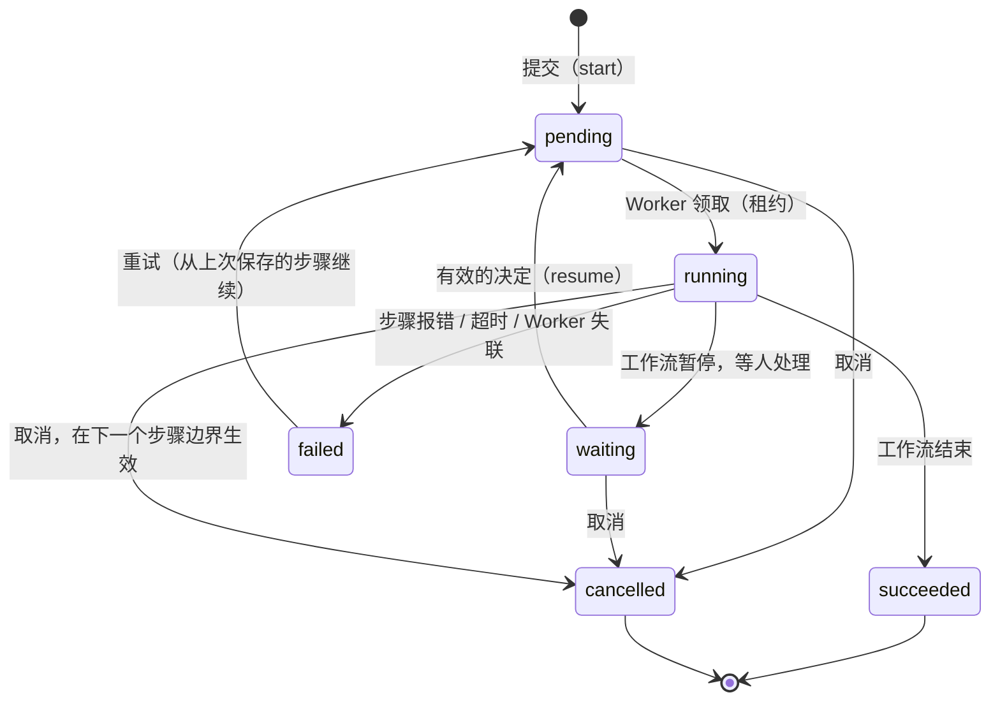

# 基础平台第一阶段：设计草案

状态：供架构师评审的草案，2026-11-26。第一、二阶段（第 12 节）已实现：`foundation/`、`workflows/echo.py`、`workflows/clip.py`、`tests/test_foundation.py`、`tests/test_clip_workflow.py`。第三阶段的第一部分，工作台页面（`foundation/web/`，由 API 提供），已实现。第二个工作流 `report`（第 6 节）已实现，平台测试套件不做修改，对 `echo`、`report`、`clip` 都能跑通（`tests/test_platform_suite.py`）。第四阶段素材入库（第 14 节）已实现，并在试点素材上跑过。上传和数据库重启后的恢复（第 15 节）、执行进程报到和运行状态页（第 16 节）、自动重启、备份和健康检查（第 17 节）已实现。工作台的外观改成了 Yuxi 网页端的样子（每个任务显示为和智能体的对话）；工作流可以提供可选的 `title(input)`，给列表里的任务起个短名字。网站打开的是平台首页；用户看到的是“应用”（`registry.APPS`：若干工作流加模块页面），带货视频剪辑是其中之一。登录和访问控制等有了员工数据再做。英文版：[PLATFORM_DESIGN.md](PLATFORM_DESIGN.md)。

平台以**任务**的形式运行**工作流**。平台负责每个工作流都需要的部分：注册工作流、登记任务、把任务交给
Worker、暂停等人确认、续跑、交付文件。工作流只负责自己的业务逻辑。Clipflow（商品 + 素材 → MP4）是第一个
工作流，它的代码不做改动，只加一个接入层。

做法参考 Yuxi（MIT 许可，阅读的是 `7c02f69` 版本）：任务先在事务里登记再投递、带租约的领取、失联 Worker
的收敛、按类型和版本注册处理器、等待点绑定到一次具体执行。代码由我们自己写：Yuxi 的代码基于异步
SQLAlchemy，并依赖它自己的工具函数；而我们的剪辑引擎是同步的，并且运行在 Windows 上（见第 8 节）。

目录：1 职责划分 · 2 任务状态 · 3 工作流接口 · 4 人工审核 · 5 Clipflow 接入层 · 6 第二个工作流 ·
7 两种队列方案 · 8 Worker 部署在哪里 · 9 数据模型 · 10 接口 · 11 测试 · 12 搭建顺序 · 13 待架构师确认的问题

---

## 1. 职责划分

| | 平台（`foundation/`） | 工作流（`workflows/<type>/`） |
|---|---|---|
| 身份 | 任务 ID、工作流类型与版本、提交人 | 业务输入（商品 ID、直播回放、脚本等） |
| 执行 | 队列、领取、租约、心跳、超时、取消、崩溃恢复 | 具体步骤；自己的进度保存在哪里（Clipflow 用 LangGraph 检查点） |
| 状态 | 面向用户的状态、当前步骤、进度、错误、事件历史 | 自己内部的业务状态 |
| 人工审核 | 等待点、决定、过期和重复提交的拒绝、谁做的决定 | 展示什么、有哪些操作、业务校验（必须修改项等） |
| 文件 | 产物记录、存储位置、下载和访问权限 | 哪些文件算交付物 |

判断标准：如果另一个毫不相关的工作流也需要它，就归平台。

```
foundation/                 平台，不知道任何视频相关的东西
  contracts.py              TaskView, Command, Outcome, WaitpointSpec, ArtifactOut
  registry.py               工作流类型 + 版本 → 接入层（用到时才加载）
  db.py, schema.sql         连接池；表结构见第 9 节
  tasks.py                  TaskRepository：创建、领取、续租、结束（写入都受租约保护）
  reviews.py                打开/回答等待点，记录决定
  artifacts.py              登记和提供文件（现在用本地目录，以后用对象存储）
  dispatch/                 Worker 如何得知有活要干（第 7 节）：现在 postgres.py，以后 arq.py
  worker.py                 Worker 主循环：领取 → adapter.advance → 记录结果
  api.py                    FastAPI：任务、决定、产物、工作流
workflows/
  clip/adapter.py           Clipflow 的接入层（第 5 节）
  report/adapter.py         一个小的第二工作流，用来证明平台可复用（第 6 节，第五阶段）
clipflow/                   剪辑引擎，不改动
```

第一版按方案建议放在同一个仓库里，作为几个顶层目录。`foundation` 不能 import `clipflow` 或
`workflows`，用 ruff 的 `flake8-tidy-imports` 禁用规则来强制。

## 2. 任务状态



- **pending** 表示"有一条待执行的指令"：`start`、`resume(decision_id)` 或 `continue`。指令存在任务行上，
  所以任何进程里的任何 Worker 都能执行它。
- **waiting** 不占用 Worker。剪辑任务可以等剪辑师几个小时，而不占执行名额。
- **succeeded** 带一个业务结果 `outcome`（`delivered`、`rejected_by_reviewer`、`stopped` 等）。审核人驳回
  分镜是正常结束，不算失败。
- **failed** 带 `error_kind`：`step_error`、`timeout`、`worker_lost`、`bad_version`。只有人或明确的策略
  （见下）才会把它送回 pending。
- `cancel_requested` 是一个标记，不是状态：正在运行的任务在下一个步骤边界停下。

**Worker 失联。** Yuxi 把租约过期的任务标为失败（"副作用结果未知"），从不自动重试。我们也这样，并且
第一、二阶段所有工作流都不自动恢复：Worker 失联 → `failed / worker_lost`，由人点重试，从上次保存点继续。
"审核后续跑"和"Worker 崩溃后恢复"是两回事，分开验收（第 11 节）。

以后证明重跑安全了，工作流可以选择开启一次自动恢复（`recover_after_crash = n`）。Clipflow 要先做到：

- **渲染写入安全。** 旧 Worker 丢失租约后可能还在渲染，和新 Worker 写同样的文件。现在渲染器用
  `ffmpeg -y` 直接写每个镜头（`<cache>/<hash>.mp4`）和最终的 `final_v<n>.mp4`。写到一半被杀掉的 Worker
  还会留下不完整的镜头文件，而缓存只检查文件是否存在，会直接复用它。两者都必须先写临时文件，再改名到位。
- **有测试证明。** 同一个时间线同时渲染两次、渲染写到一半被杀掉，两种情况最后都必须得到有效的 MP4，
  且校验值与登记的产物一致。

做到之后 Clipflow 才设为 `n = 1`。

*进展（2026-11-26）：* 两个前提都已满足。渲染器把每个镜头和最终视频先写到临时文件，写完再一步改名到位；
缓存的镜头只有 ffprobe 能读出来才会复用；被杀掉的渲染留下的临时文件一天后清理。
`tests/test_render_safety.py` 会在写入过程中杀掉真实的渲染进程，也会同时对一个时间线渲染两次。剩下的是
平台这一侧（工作流允许时，把失联的任务自动重新排队一次），等架构师对第 13 节问题 2 的答复再做。

每次状态变化和步骤进度都追加写入 `task_events`。工作台展示的历史、出问题时的复盘，都读这张表。

## 3. 工作流接口

只有一个接口，只由 Worker 调用：

```python
class Workflow(Protocol):
    type: str                       # "clip"
    version: int                    # 已保存的输入或状态不再兼容时加一
    input_model: type[BaseModel]    # 提交时校验，任务创建之前
    recover_after_crash: int = 0
    timeout_s: float = 3600         # 每次 advance() 调用的上限，不是整个任务的

    def advance(self, task: TaskView, command: Command, ctx: StepContext) -> Outcome: ...
    def check_decision(self, waitpoint: WaitpointView, body: dict) -> str | None:  # 可选，快速检查
        return None
```

`advance` 一直运行，直到工作流结束或需要人处理，返回下面之一：

```python
Waiting(key, subject_version, payload, actions, decision_schema, view, engine_key)
Finished(outcome, artifacts: list[ArtifactOut], summary: dict)
# 抛出异常 = 失败（step_error），由平台记录
```

`StepContext` 是工作流可以用的东西：

| 方法 | 作用 |
|---|---|
| `ctx.step(name, progress=None)` | 记录当前步骤；在步骤之间调用 |
| `ctx.check()` | 租约丢失或已请求取消时抛出 `Stop`；在步骤之间调用 |
| `ctx.artifact_dir` | 本任务交付物的目录 |
| `ctx.log(kind, data)` | 往任务历史里加一条业务事件 |

租约由单独的心跳线程续期，所以长步骤（比如 3 分钟的渲染）不会丢失租约。工作流通过 `ctx.check()` 得知
自己必须停下。

**写入保护（fencing）。** Worker 的每次写入（结束、打开等待点、进度）都是
`UPDATE … WHERE id = %s AND worker_id = %s AND lease_expires_at > now()`。丢失租约的 Worker 即使还在运行，
也无法发布结果或打开等待点。剩下的风险是：这样的 Worker 会把当前步骤跑完，直到下一次 `ctx.check()`，
期间可能和新的执行者同时运行。对 Clipflow 来说，这个步骤的输出按内容寻址，重复的工作只是浪费，不会出错。

## 4. 人工审核：所有工作流共用一套机制

**等待点**是向人提出的一个问题，绑定到一个任务和对方看到的那个版本。

```
waitpoint: id, task_id, key ("confirm_plan"), subject_version (分镜 v3),
           payload（展示什么）, actions (["approve","edit","reject"]),
           decision_schema (JSON Schema), view ("clip.plan_review"), engine_key, status
```

提交决定 `POST /tasks/{id}/decisions {waitpoint_id, body, client_request_id}`，在一个事务里完成：

1. 锁住任务行。`client_request_id` 已用过 → 返回第一次的响应（重复点击、网络重试）。不会执行两次。
2. 任务不在 `waiting`，或 `waitpoint_id` 不是当前打开的那个 → **409**，并返回当前等待点。过期的浏览器
   页面就是这样被拦下的。
3. `workflow.check_decision` 返回问题 → **422**，等待点保持打开。工作流用生成 `decision_schema` 的同一个
   Pydantic 模型检查回答的格式，所以页面和检查不会对不上，平台也不需要 JSON Schema 校验库。没有
   `check_decision` 的工作流只检查"是不是给出的操作之一"。
4. 保存决定（谁、何时、内容），把等待点标为已回答，任务设为 `pending`、指令为 `resume(decision_id)`，
   提交事务，通知 Worker。

两层检查，是有意这样分的：

- **平台**：这是不是对当前打开的那个问题的回答？所有工作流都一样。
- **工作流**：这个回答是否有效？Clipflow 已经在图里做了这件事（`nodes/_human.py`：版本不符、有必须修改项
  时直接批准、镜头不存在等）。如果它拒绝了决定，图会带着 `error` 再次暂停。接入层返回一个新的 `Waiting`，
  旧等待点标为 `superseded`，审核人看到原因。不会丢东西，也不会按无效的决定继续执行。

可选地，接入层可以把便宜的检查提前到 `check_decision`，这样审核人立即得到 422，而不用经过 Worker 绕一圈。
第二阶段先用绕一圈的方式（规则不重复写），再测量速度是否够用。

工作台按 `view` 渲染等待点：Clipflow 注册自己的页面（分镜、MP4 预览）；其他工作流使用一个通用表单，
根据 `decision_schema` 和 `payload` 生成。

## 5. Clipflow 接入层

```python
class ClipWorkflow:
    type, version = "clip", 1
    input_model = ClipInput          # 不含 run_id 的 RunRequest（run_id 由平台提供）
    recover_after_crash = 0          # 渲染写入安全之前由人工重试（第 2 节）

    def advance(self, task, command, ctx):
        cfg = {"configurable": {"thread_id": task.engine_ref["thread_id"]}, "recursion_limit": 80}
        snap = self.app.get_state(cfg)
        match command.kind:
            case "start" if not snap.values:
                inp = {"input": RunRequest(run_id=task.id, **task.input).model_dump(mode="json")}
            case "resume" if self._open(snap, command.waitpoint.engine_key):
                inp = Command(resume={command.waitpoint.engine_key: command.decision.body})
            case _:
                inp = None           # 崩溃恢复和重试：从上一个检查点继续
        for _ns, update in self.app.stream(inp, cfg, context=self.ctx, stream_mode="updates", subgraphs=True):
            ctx.check()
            ctx.step(next(iter(update)))
        return self._outcome(self.app.get_state(cfg), ctx)
```

- **ID 对应。** `thread_id = task_id = RunRequest.run_id`，同时存在 `tasks.engine_ref` 里，以后两者需要不同时
  无需迁移数据。
- **暂停 → 等待点。** 三个暂停点并不一样，所以分别映射。`engine_key` 一律是 LangGraph 的 `Interrupt.id`；
  按中断 ID 续跑，回答只会送到那一个暂停点（已在 LangGraph 1.2 上验证）。

  | Clipflow 暂停点 | `key` | `subject_version` | `actions` | Clipflow 期望的回答 | 回答无效时 |
  |---|---|---|---|---|---|
  | 找不到商品（`nodes/slice.py`） | `needs_input` | payload 里没有，存为 `0` | payload 里没有；接入层设为 `["provide_range", "cancel"]` | `{start, end}`（`1:02:30` 或毫秒），或 `{action: "cancel"}` | Clipflow **不会**重新询问：时间缺失或无法解析会让步骤失败。所以 `check_decision` 先检查（同样用 `parse_ms`，结束晚于开始），在续跑之前就返回 422 |
  | 分镜确认（`nodes/plan.py`，`_human.ask`） | `confirm_plan` | `pause["version"]`，分镜版本 | `pause["actions"]`（有必须修改项时没有批准） | 不含 `stage` 的 `Decision`：version、verdict、edits、reason | Clipflow 带 `error` 重新询问；接入层返回新的 `Waiting`，旧等待点变为 `superseded` |
  | 成片审核（`nodes/video.py`，`_human.ask`） | `review_video` | `pause["version"]`，时间线版本 | `pause["actions"]` | 同上 | 同上 |

  后两个的 `decision_schema` 由 Clipflow 的 `Decision` 模型生成（去掉 `stage`，由 Clipflow 自己加），
  `must_fix`、`may_waive` 和 `error` 放在 `payload` 里给审核页面。平台把审核人和时间以 `by`、`at` 写进
  回答，这样 Clipflow 自己的记录里也有审核人。
- **指令可重复执行。** 如果 Worker 在 LangGraph 已经消费了回答之后才挂掉，恢复流程会重新执行这条指令。
  接入层先查检查点：那个中断已经不在了，于是直接继续（`None`），而不是再发一次回答。检查点已存在的
  start 也是直接继续。这和现在 `run.continue_thread` 的规则一致。
- **结束与交付物。** Clipflow 的 `Delivery` 目前只保证 `video_path`。`cover_path` 和 `caption_file` 在契约里有，
  但交付步骤从不填写（字幕已经压进视频）。所以：

  | 来自 Clipflow | 平台产物 | 是否必需 |
  |---|---|---|
  | `Delivery.video_path` | `video`（mp4、sha256、大小） | 必需：文件不存在 → `failed`，而不是 `succeeded` |
  | `Delivery.cover_path` | `cover` | 只在有值且文件存在时 |
  | `Delivery.caption_file` | `captions` | 只在有值且文件存在时 |
  | Clipflow 产物库里最终批准的 `Plan` | `plan`（JSON） | 必需 |
  | `qc_passed`、`waived`、分镜和时间线版本 | 任务的 `summary`，不是文件 | — |

  图的 `status` 为 `done` → `Finished("delivered")`。`rejected` / `stopped` / `cancelled` → 以对应结果
  `Finished`，没有交付物；`stopped` 会把 Clipflow 的 `delivery_blocked:` 标记放进 summary。Clipflow 自己的
  重试用完后仍然报错 → `failed`；`POST /retry` 会发 `continue`。
- **留在 Clipflow 内部的。** LangGraph 检查点（同一个 Postgres，自己的表）、按内容哈希的产物库和缓存、
  各个 Agent、规则和审核逻辑。平台从不读取 Clipflow 的内部状态，只看接入层返回的结果。
- **Clipflow 需要改的。** 不必改动。`clipflow/api.py`（在 API 进程里用线程池跑任务）保留为开发工具，
  不再作为任务的运行方式。

一条剪辑任务的完整流转：

```
POST /tasks {type:"clip", input:{mode:"slice", product_id, source_videos…}}
  → 写 tasks 行（pending, start）+ task_events，提交，通知
Worker 领取 → adapter.advance(start) → 图运行到 confirm_plan → Waiting
  → 写等待点（open），任务 waiting，Worker 释放
剪辑师：GET /tasks/{id} 看到等待点 → POST /decisions {waitpoint_id, approve, v1}
  → 写决定，任务 pending（resume），通知
任意 Worker（可以是新进程）→ advance(resume) → 渲染 → 质检 → review_video → Waiting
剪辑师批准 → advance(resume) → 交付 → Finished(delivered, [mp4, 分镜] + 有的话加封面/字幕)
  → 写产物记录，任务 succeeded；GET /artifacts/{id} 下载 MP4
```

## 6. 第二个工作流复用同一套机制

第五阶段建议做一个刻意很小的工作流 `report`：输入文字 → 模型起草文档 → 一次审核（批准 / 修改 / 驳回）→
输出 Markdown 或 DOCX 文件。全部代码大致如下：

```python
class ReportWorkflow:
    type, version = "report", 1
    input_model = ReportInput        # {topic, notes}

    def advance(self, task, command, ctx):
        # 普通代码或它自己的小 LangGraph 都可以
        ...
        return Waiting(key="approve_draft", subject_version=n, payload={"draft": text},
                       actions=["approve", "edit", "reject"], decision_schema=DRAFT_DECISION,
                       view="generic.text_review", engine_key=f"draft-{n}")
        ...
        return Finished("delivered", [ArtifactOut("report", ctx.artifact_dir / "report.docx")])
```

再在 `registry.py` 里加一行。下面这些它不用写一行代码就能得到：提交和列表、排队、领取、租约和崩溃
处理、超时、取消、重试、历史记录、带过期和重复提交保护的决定接口、产物下载和权限、通用审核页面。

"可复用"的检验标准：**平台集成测试套件不做任何修改，对两个工作流都能跑通**（第 11 节）。如果加 `report`
需要改 `foundation/`，说明边界划错了，要修的是边界，而不是加特例。

**已实现（2026-11-26）。** `workflows/report.py`：输入主题、要点、读者和篇幅；模型起草（和 Clipflow
用同一套网关配置）；审核人可以批准、直接改文字、写意见让模型重写（`revise`）或驳回；批准后的文字输出为
`report.md`。目前只输出 Markdown；DOCX 需要一个转换工具，现在还没有。它的保存点是任务目录里的一个小
`state.json`，所以重写失败后点重试，会带着同样的意见重新改写，而不是从头起草。

加它没有改 `foundation/` 里任何专门针对 `report` 的东西。但它暴露了边界上的三处缺口，都按所有工作流通用的
方式补上了：

- 工作流可以声明 `label`（给人看的名称），任务列表和表单都用它；
- 新建任务的表单可以根据任何工作流的输入模型自动生成（文字、数字、是否、选项、列表），新工作流不用写页面代码；
  Clipflow 仍用自己的表单；
- 工作流因为上一个回答没被接受而再次提问时，原因（`Waiting.error`）会写进新问题的 payload，通用审核页面
  就能显示出来（之前 `echo` 的原因显示不出来）。

通用文字审核页面只显示这个问题提供的动作对应的按钮，所以 `revise` 不需要新页面。一个真实的 `report` 任务
在真实平台上、用真实模型跑通了：起草、按意见重写、批准、下载。

## 7. Worker 如何得知有任务：两种方案

两种方案里，**Postgres 都是唯一的事实来源**：任务行、状态、租约、等待点和决定都在 Postgres。两种方案的
区别只在于怎么唤醒 Worker。

### 方案 A：Worker 直接从 Postgres 领取（当前推荐）

```sql
UPDATE tasks SET status = 'running', worker_id = %(me)s, attempt = attempt + 1,
       heartbeat_at = now(), lease_expires_at = now() + interval '60 seconds'
WHERE id = (SELECT id FROM tasks
            WHERE status = 'pending' AND workflow_type = ANY(%(types)s) AND not_before <= now()
            ORDER BY priority DESC, created_at
            FOR UPDATE SKIP LOCKED LIMIT 1)
RETURNING *;
```

- 提交和审核决定在自己的事务里执行 `NOTIFY tasks`。Postgres 只在事务提交成功后才发出 NOTIFY，所以
  Worker 不会被一个不存在的任务唤醒。Worker 用 `LISTEN` 接收通知，同时每 5 秒查一次作为兜底，漏掉通知
  最多晚 5 秒。
- `SKIP LOCKED` 让多个 Worker 同时领取，既不互相阻塞，也不会重复领取。
- 不需要补发机制：任务行本身就是队列，不会出现"已保存但没投递"。

| 优点 | 缺点 |
|---|---|
| 少运行、备份、监控一个服务 | 主循环要自己写（约 150 行）：领取、心跳、收敛 |
| 保存和入队是同一个事务 | 没有现成的定时任务、任务结果和监控面板 |
| 普通同步 psycopg，原生支持 Windows | 每个 Worker 占一个 LISTEN 连接 |
| 好测试：只需 Docker 里一个数据库 | 任务量极高时领取语句会成为热点 |

规模估算：预计每天几十个任务，每个几分钟。`SKIP LOCKED` 队列通常能承受远高于此的负载，现阶段不用
担心热点。

### 方案 B：通过 Redis + ARQ 投递（Yuxi 的做法）

- 提交时保存任务行（pending）并提交事务，然后 `enqueue_job("run_task", task_id)` 到 ARQ 队列（每种工作流
  或每种执行环境一个队列）。
- ARQ Worker 收到任务 ID 后，用同样的条件 `UPDATE … WHERE status = 'pending'` 领取该行。重复的消息会发现
  任务已被领取，什么也不做。
- 因为入队发生在事务提交之后，入队可能失败。补发器（Worker 启动时以及每 30 秒）会把所有超过几秒仍是
  pending 的任务重新投递。这就是 Yuxi 的 `publish_pending_jobs`。

| 优点 | 缺点 |
|---|---|
| 与 Yuxi 一致，它的代码和文档可以一一对照 | 多一个服务（Redis），还要一个补发器保持两边一致 |
| 自带按队列路由、定时任务、任务超时 | ARQ 是 asyncio 的；我们的引擎是同步的，每个任务仍要放到线程里跑 |
| Redis 还可用于实时进度事件和取消信号 | 在 Windows 上 ARQ 需要 selector 事件循环（Yuxi 有设置），又多一项要测 |
| 可扩展到多台机器和高负载 | ARQ 是个小项目，依赖它之前要确认维护是否活跃 |

### 推荐

**现在用方案 A。** 我们的负载很小，Worker 必须跑在 Windows 上，而方案要求的每一项保证（先保存后投递、
只有一个执行者、崩溃后可恢复）在两种方案里都来自 Postgres。Redis 只会多出一个需要保持一致的系统，并不会
让任何东西更安全。

**出现下面任一情况时切换到方案 B**：多台机器上的 Worker 需要跨机器快速唤醒；我们本来就需要 Redis
（向工作台实时推送进度、共享缓存）；需要定时任务（比如每晚扫描新的直播回放）。第四阶段的素材入库最有可能
触发切换。

### 怎样让切换成本很低

只有一个模块知道用的是哪种方案：

```python
class Dispatcher(Protocol):            # foundation/dispatch/
    def notify(self, conn, task_id: str, workflow_type: str) -> None: ...  # 在事务里调用
    def wait(self, types: list[str], timeout_s: float) -> str | None: ...  # 返回任务 ID，None = 领取任意一个
```

- Postgres 版：`notify` 执行 `NOTIFY`，`wait` 阻塞在 `LISTEN` 上并返回 None。
- ARQ 版：`notify` 注册一个事务提交后的回调来入队；ARQ 的任务函数调用同一个 `worker.execute(task_id)`。
- `TaskRepository.claim(task_id | None)`、状态机、租约、收敛、等待点、决定和产物，在两种方案里都是同一份
  代码。接入层完全不知道有两种方案。

切换步骤：部署 Redis，把 `config.yaml` 里设为 `dispatch: arq`，启动 ARQ Worker。已经 pending 的任务由补发器
接走。切换期间两种 Worker 可以同时运行，因为领取在 Postgres 里是原子的。切回去就是反过来做一遍。

## 8. Worker 部署在哪里

目前剪辑 Worker 必须跑在这台 Windows 工作站上：中文配音用的是 Windows System.Speech，语音识别用本机 GPU，
ffmpeg 也在本机。所以：

- Postgres 仍在 Docker 里；API 和 Worker 是 Windows 上两个普通的 Python 进程（`python -m foundation.api`、
  `python -m foundation.worker --types clip`）。按方案要求分成两个进程：重启 API 不会影响正在运行的任务。
- 每个 Worker 声明自己处理哪些工作流类型（`--types clip,report`）。任务就是这样交给合适的执行环境的：
  以后 `clip` 可以由一台 Linux GPU 机器处理，`report` 由一个容器处理。
- 每个 Worker 的并发：这台工作站一次只跑 1 个剪辑任务（只有一块 GPU，ffmpeg 很吃资源）。每个任务内部
  Clipflow 已经最多并行 6 个模型调用。
- **跨机器的文件**：只有一台机器时可以用本地目录。Worker 分布在两台机器上时，素材、Clipflow 的产物库和
  交付文件必须放在共享存储或对象存储上；只有数据库检查点不足以恢复任务。`artifacts.py` 从一开始就定义
  存储接口（本地 / 兼容 S3 的云存储），现在只实现本地版。

## 9. 数据模型（第一版）

```sql
tasks(
  id text pk, workflow_type text, workflow_version int,
  input jsonb, engine_ref jsonb,                       -- {"thread_id": …}
  status text check (status in ('pending','running','waiting','succeeded','failed','cancelled')),
  command jsonb,                                       -- {"kind":"start"|"resume"|"continue", "decision_id":…}
  outcome text, current_step text, progress real,
  error text, error_kind text,
  attempt int, auto_recoveries int, cancel_requested bool,
  worker_id text, heartbeat_at timestamptz, lease_expires_at timestamptz,
  priority int, not_before timestamptz,
  created_by text, client_request_id text unique,      -- 提交幂等
  created_at, updated_at, finished_at timestamptz)
  index (status, workflow_type, priority, created_at), index (status, lease_expires_at)

task_events(id bigserial, task_id, at, kind, data jsonb)      -- 只追加的历史

waitpoints(id text pk, task_id, key, subject_version int, payload jsonb, actions jsonb,
           decision_schema jsonb, view text, engine_key text,
           status text check (status in ('open','answered','superseded','cancelled')),
           opened_at, closed_at)
  unique (task_id) where status = 'open'                       -- 同一时间最多一个打开的问题

decisions(id text pk, waitpoint_id, task_id, body jsonb, by text, at timestamptz,
          client_request_id text unique)

artifacts(id text pk, task_id, kind text, storage text, location text,
          sha256 text, bytes bigint, mime text, created_at)
```

工作流本身在代码里注册（和 Yuxi 一样），不放在表里。每个任务记录创建时的工作流版本；Worker 遇到自己没有的
版本会拒绝执行（`error_kind = bad_version`），而不是用新代码去跑旧状态。表结构由一条明确的命令
`python -m foundation.db migrate` 创建，不在 API 启动时自动建表。

## 10. 接口（第一版）

| | |
|---|---|
| `GET  /api/v1/workflows` | 已注册的类型、版本、输入的 JSON Schema |
| `POST /api/v1/tasks` | `{workflow_type, input, client_request_id}` → 202 `{task_id}`；输入无效返回 422 |
| `GET  /api/v1/tasks?status=&type=` | 列表 |
| `GET  /api/v1/tasks/{id}` | 状态、步骤、进度、结果、错误、当前打开的等待点、产物 |
| `GET  /api/v1/tasks/{id}/events` | 历史 |
| `POST /api/v1/tasks/{id}/decisions` | `{waitpoint_id, body, client_request_id}` → 202；过期 409；无效 422 |
| `POST /api/v1/tasks/{id}/retry` | failed → pending（`continue`） |
| `POST /api/v1/tasks/{id}/cancel` | 设置 `cancel_requested`；pending / waiting 立即取消 |
| `GET  /api/v1/artifacts/{id}` | 检查权限后下载 |

登录和按资源的访问控制在第三阶段随工作台一起做；在那之前记录 `created_by`，API 只监听本机。

## 11. 测试

方案里的每条验收标准都对应一个自动化测试。集成测试使用 Docker 里的 Postgres，数据库没运行时跳过
（和现在的 `tests/test_postgres.py` 一样）。

**平台测试套件**，对每个已注册的工作流各跑一遍（一个快速的假工作流、`report`、以及基于测试数据的 `clip`）。
已实现为 `tests/test_platform_suite.py`：每个工作流只需提供一个合法输入、让某一步失败一次的办法、以及
"修改"长什么样。三个工作流都跑测试 1、2、3、5、8、9（换一个 Worker，同一进程）、10–12、13（等待中取消）
和 14。测试 4、6、7、15、运行中取消，以及跨真实进程的测试 9，测的是平台自身的机制，留在
`tests/test_foundation.py` 里只用 `echo` 跑。
下表是全部测试，也就是第 6 节说的复用证明：

| # | 测试 | 通过条件 |
|---|---|---|
| 1 | 提交 → Worker → 结束 | succeeded，产物已登记且可下载 |
| 2 | 用同一个 `client_request_id` 提交两次 | 只有一个任务 |
| 3 | 4 个 Worker 抢 1 个任务 | `advance` 只被调用一次 |
| 4 | 唤醒消息送达两次 | 只执行一次 |
| 5 | 步骤报错 | failed、`step_error`、历史里有错误；`retry` 从保存的步骤继续 |
| 6 | 步骤进行中杀掉 Worker 进程（`taskkill`） | 租约过期，收敛为 `failed / worker_lost`；`retry` 后继续并完成 |
| 7 | 已丢失租约的 Worker 尝试结束任务 | 写入被拒绝，结果不发布 |
| 8 | 等待时释放 Worker | 第一个任务等待期间，同一个单槽 Worker 能跑第二个任务 |
| 9 | 暂停、停掉 Worker 进程、启动新进程、提交决定 | 在新进程里续跑并完成 |
| 10 | 用旧的 `waitpoint_id` 提交决定 | 409，没有续跑 |
| 11 | 同一个决定发送两次 | 只续跑一次，两次响应相同 |
| 12 | 工作流拒绝的决定 | 带原因的新等待点；旧等待点 `superseded` |
| 13 | 在 pending / waiting / running 时取消 | cancelled；running 在下一个步骤边界停下 |
| 14 | 任务的工作流版本 Worker 没有 | failed、`bad_version` |
| 15 | 超时 | failed、`timeout`，Worker 名额释放 |

**两项验收分开。**

- *审核后续跑*：测试 9–12 和下面的真实数据验收。引擎这一侧（检查点存在 Postgres、换进程续跑）已经由
  `tests/test_postgres.py` 和真实任务验证过。
- *Worker 崩溃后恢复*：第一、二阶段是测试 6，人工重试。Clipflow 的自动恢复是以后单独的一项验收：
  第 2 节里的两个渲染测试。

**Clipflow 专属测试**（用测试数据，不调用模型）：三个暂停点各自变成正确的等待点；按中断 ID 续跑；崩溃后
重新执行的 resume 会直接继续而不是重复回答；`rejected` 以 `succeeded / rejected_by_reviewer` 结束。

**第二阶段验收，真实数据**（手动，标记为慢测试）：试点任务通过平台 API 提交，在 `confirm_plan` 暂停，杀掉
并重启 Worker 进程，批准，`review_video` 批准，通过 `/artifacts` 下载 MP4，质检通过。

## 12. 搭建顺序

第一阶段分两步，每步验收后再做下一步：
1. **任务登记 → 独立 Worker 领取 → 查询状态。** `schema.sql`、带写入保护的 `TaskRepository`、带心跳和
   收敛的 Worker 主循环、Postgres 投递器、提交 / 状态 / 重试 / 取消接口。用一个简单工作流验收：测试 1–7、13–15。
2. **暂停和续跑。** 等待点、决定、决定接口。测试 8–12。

第二阶段（接入 Clipflow）：接入层、Clipflow 专属测试、用 `clip` 跑平台测试套件，然后做真实数据验收。

`report` 工作流（第五阶段）很小，第一版可以在第二阶段之后紧接着做，在工作台搭起来之前就尽早检验边界。

## 13. 待架构师确认的问题

前两个最重要。

1. 第一阶段只用 PostgreSQL 承担任务领取（方案 A），保留 `Dispatcher` 接口以便以后换成 ARQ：是否同意？
2. Worker 失联：第一、二阶段所有工作流都是 `failed` 加人工重试；Clipflow 的自动恢复要等第 2 节的渲染写入
   测试通过后再开。是否同意？
3. 决定的业务校验留在工作流里（Clipflow 带原因再次暂停），`check_decision` 作为可选的快速通道。还是应该
   由平台要求提前校验？
4. Worker 用同步技术栈（psycopg、线程），因为引擎是同步的且跑在 Windows 上；API 仍然可以是异步的。有无异议？
5. 任务输入直接存在任务行里（`jsonb`），还是存一个指向已保存输入文档的引用？
6. 按方案所说，第一、二阶段不包括：细粒度权限、知识图谱、MCP、多租户、统一模型配置。有没有需要提前
   纳入的？

## 14. 第四阶段：素材入库（2026-11-26 已实现）

方案的验收标准：**选商品即可召回已处理同款片段，候选有源文件和时间段。**

**做法。** 入库是平台上的又一个工作流 `ingest`，一个媒体文件一个任务。除了下面一个通用扩展点，平台没有
改动；排队、重试、审核问题及其过期和重复提交保护都来自 `foundation/`，平台测试套件（第 11 节）不做修改，
把它当作第四个工作流也能跑通。

| | 直播回放 | 商品实拍素材 |
|---|---|---|
| 步骤 | 转写 → 商品定位 Agent 逐款在整场回放里找 | 每 2 秒抽一帧 → 画面理解 Agent 打标 |
| 结果 | `sell_block` 片段：主播在讲某一款的时段，带能认出这款的原话 | `shot` 片段：连续清楚拍到这款的镜头，带景别、颜色、清晰度 |
| 审核 | 默认要：人确认、改时间、改商品、删掉或添加片段 | 默认不要（35 条素材各问一次太多）；素材库里显示为“未确认” |

具体工作是 Clipflow 的代码（`clipflow/ingest.py`），和出片时用同样的 Agent、分块和缓存，所以入过库的回放，
出片时不再花模型调用。出片只使用人确认过的讲解段；没确认的，照旧自己在回放里找。

**素材库**（`clipflow/library/`）是 Clipflow 自己的 Postgres schema `library`，有自己编号的迁移文件
（`foundation.db.migrate(files=…)`）：`assets`（一个文件一行）和 `segments`（文件、商品、类型、起止时间、
标签或原话、谁确认的、哪个任务）。写入时在一个事务里替换同一文件对同一批商品的旧结果，所以重试或重新扫描
都不会出错。Clipflow 通过原有的 `AssetLibrary` 接口读取（`PostgresLibrary`）；素材库里没有的商品，退回
试点的商品资料。没有用向量数据库：召回按商品。以后要按意思搜（“讲面料的镜头”），可以在同一张表上加 pgvector。

**登记文件。** 工作台表单（根据 `IngestInput` 自动生成），或文件夹扫描
`python -m workflows.ingest scan material [--every 600]`：`<款名>/<颜色>/*.mov` 是这款这个颜色的实拍素材，
其他视频都当作回放，在商品库的每一款里找。每个文件按大小和修改时间只提交一次（`client_request_id`），
重复扫描不会产生新任务。浏览器上传还没做：单机时把文件拷进文件夹；多机部署需要共享存储（方案“文件存储”一节）。

**平台扩展点：模块 API。** 素材库页面需要的不只是任务，所以业务模块可以登记自己的 API 路由
（`registry.MODULES`，和工作流一样按导入路径登记），挂在 `/api/v1/<名字>/` 下。`library` 提供商品列表、
按商品召回、带 Range 的文件播放和打过标的截图。文件只能按素材库 id 访问。

**工作台。** 素材库：选一款，看到每个片段的文件和时段，从片段开头播放（手机拍的 HEVC 素材有的浏览器放不了，
截图总能看到）。确认入库片段：建议的片段、原话、可改的时间和商品，▶ 从每段开头播放。

**第一次真实运行**（示例裤A的 4 段试点回放和 35 条实拍素材）：扫描登记了 39 个任务。第 (2) 段找到 10 个
讲解段（和之前出片时找到的位置一致），第 (3) 段 1 个，无编号段和第 (1) 段没有；实拍素材都打标成了镜头。
两段回放的确认留给剪辑师。

**还没解决的。** 回放是逐款查找的：几款没问题，商品库有几百款时会很慢（届时换成一次判断“这一段在讲哪一款”
的 Agent）。实拍素材要放在正确的款名和颜色文件夹里。商品资料改了之后重新入库要手动做（文件时间变了再扫描，
或从表单重新提交）。

## 15. 上传，以及数据库重启时不中断（2026-11-26 已实现）

**上传**（`foundation/uploads.py`，迁移 004）。方案里参考 Yuxi `uploads.py` 的做法：文件先暂存，再由后台任务
处理。任何工作流都能接收上传的文件：在输入里声明一个 `UploadRef` 类型的字段；工作台为它画一个选文件的控件；
上传没完成之前，平台拒绝创建任务（422）；工作流用 `ctx.upload_path(id)` 打开文件。`ingest` 既可以用上传的
文件，也可以用服务器上的路径。

回放一个 1–2 GB，所以文件按 16 MB 分块上传（先 `POST /uploads`，再 `PUT /uploads/{id}?offset=N`）。每块只在
平台已经收到的位置接收，否则 409 告诉页面从哪里继续，所以断线或重发的请求都能接着传，不会漏也不会重。
页面自己处理（每块最多重试五次）。最后一个字节到达时计算校验值并改成正式文件名；崩溃前写了但没记录的字节，
下一块会先截掉。上传的文件放在平台存储里（`uploads/<id>/<文件名>`），所以多机部署时和交付文件一样需要共享
存储或对象存储。还没做：清理没被任务用到的旧上传。

**数据库重启后不用再重启 Worker。** 以前每个长期连接在 Postgres 重启或网络断开后就永久失效：

| | 以前 | 现在 |
|---|---|---|
| 平台和素材库的连接池 | 坏掉的连接可能被再次使用 | 每次使用前检查连接；连接名为 `foundation-<schema>` |
| Clipflow 的检查点 | Worker 整个生命周期只用一个连接：之后所有出片任务都失败 | 一个会检查连接的小连接池 |
| 唤醒监听 | 出错就让 Worker 退出 | 下次等待时重新连接；中间靠轮询兜底 |
| Worker 主循环 | 领取任务时出错就让 Worker 退出 | 记日志、等待（每次更久，最多 60 秒）、再试 |
| 心跳 | 续租失败一次就停止任务 | 上次续租还有效时一直重试；在租约到期前才放弃，保证不会和接手的 Worker 冲突 |

断线那一刻正在跑的步骤仍可能失败，点重试即可继续。测试从服务器端断开连接（`pg_terminate_backend`），只断
自己名字的连接。

## 16. 运维：队列有人在处理吗？（2026-11-26 已实现）

以前执行进程挂了，任务就一直显示“排队中”，看不出原因。现在（`foundation/ops.py`，迁移 005）：

- **执行进程报到。** 每个 Worker 每 10 秒报到一次（名字、处理的类型、正在跑的任务），正常退出时也会记录。
  30 秒没报到就算失联。这和任务租约是两回事：租约保护的是一个任务；报到回答的是“这个队列有没有人在处理”。
- **`GET /api/v1/health`**：按工作流类型给出排队、运行中、待审核、24 小时内失败的数量，排得最久的任务，
  在线的执行进程；再加上直白的提醒：某类任务在排队但没有执行进程、排队超过 10 分钟、有问题在等人审核。
  数据库连不上时返回 503。
- **工作台。** 新增“运行状态”页面显示以上内容；会卡住工作的提醒也显示在任务列表上方，菜单上出现红点。
  浏览器标签页标题显示待审核数量（`（3 待审核）剪辑工作台`），每个页面每 15 秒刷新一次。
- **清理**：`python -m foundation.ops cleanup [--apply]` 先列出、再删除没传完的上传（24 小时没有新数据块）
  和 30 天没有任务用过的已完成上传。默认只列出不删。

在真实工作台上验证过：关掉 echo 的执行进程并提交一个 echo 任务，30 秒后该进程显示“失联”，echo 那一行显示
“没有”，两个页面都出现提醒；重启后任务马上跑完。

还没做：工作台以外的告警（邮件或 webhook），以及 Clipflow 自己的健康状况（模型网关响应时间、GPU），
这些适合作为模块在自己的 API 旁边提供检查。

## 17. 无人值守时保持运行（2026-11-26 已实现）

- **启动器自动重启崩溃的进程。** `python -m foundation.dev` 看管 API 和每种类型的一个 Worker：进程退出后
  1 秒重启，如果一直失败就等 2、4 …… 最多 60 秒；连续运行 5 分钟后算恢复正常。崩溃的 Worker 正在跑的任务，
  仍然在租约到期后变成 `failed / worker_lost`，由人点重试（自动重新排队还在等架构师答复第 13 节问题 2）。
  验证方法：杀掉真实的 report Worker，1 秒后新的已经在运行。
- **数据库备份。** `python -m foundation.ops backup [--keep 14]` 用 `pg_dump`（本机装了就用本机的，否则用
  Postgres 容器里的）导出整个数据库（平台、素材库、Clipflow 检查点），先确认文件里列得出表，再改成正式文件名，
  保留最新 14 份。`restore-test <文件>` 把备份恢复到一个临时数据库、数行数、再删掉：备份只有恢复过才算可信。
  第一次真实运行：0.7 MB；恢复出 49 个任务和 35 个素材片段，和线上数据库一致。文件（上传、交付文件、素材）
  不在备份里，需要另外复制。
  已在这台工作站上建了计划任务 `clipflow-backup`（2026-11-26），每晚 02:00 运行，输出追加到 `backups/backup.log`：
  `schtasks /Create /SC DAILY /ST 02:00 /TN clipflow-backup /TR "cmd /c cd /d D:\work\1 && .venv\Scripts\python.exe -m foundation.ops backup >> backups\backup.log 2>&1"`。
  只在 Administrator 登录、电脑开着时运行（和 Docker Desktop 一样）；错过的那一晚会跳过，不会补做。
  从计划任务第一次运行出的备份已经恢复验证过。
- **运行状态页上的健康检查**，后台每 5 分钟跑一次：写文件的磁盘剩余空间（低于 20 GB 提醒），以及各模块自己的
  检查，和模块 API 一样登记（`registry.CHECKS`）。Clipflow 的检查：模型网关（发一个只要 1 个字的请求并计时；
  失败或超过 20 秒就提醒）和 GPU。检查失败也会在任务列表上方提醒。
